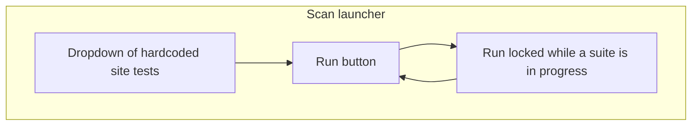

# Scan Launcher - Plan

## Goal Capsule

- **Objective:** Ron can pick one of the scanner’s existing hardcoded site tests from a dropdown and start that suite with a Run button.
- **Product authority:** This plan owns the launch control panel only. The post-scan scoreboard, screenshots, findings triage, and adding a new site are surrounding work, not active scope.
- **Open blockers:** None.

---

## Product Contract

### Summary

A small control panel replaces “run a terminal command” as how Ron starts a scan.
He selects one existing site test from a dropdown and hits Run.
While that suite is running, Run stays locked.

### Problem Frame

Site tests are hardcoded in the scanner and started from npm scripts in a terminal.
Ron sits in front of the results after a scan and asked for a JavaScript dashboard, then reversed the first cut: the missing piece is starting a named suite from the UI, not a scoreboard that you open after Allure.

### Key Decisions

- Launcher first, not the scoreboard. (session-settled: user-directed — chosen over the current-run scoreboard as v1: “actually let’s do the reverse”) Governs R1, R2, R3.
- Dropdown is the existing hardcoded site tests, not a form to add a site. (session-settled: user-directed — chosen over adding a new site in this cut: pick from the list already in the scanner) Governs R2.
- Lock Run while a suite is in progress; no progress view in v1. (session-settled: user-approved — chosen over a progress view: long runs can just disable the button until done) Governs R4, R5, R6.

### How This Work Fits Together

<!-- ce-section: work-relationships -->

This plan owns the scan launcher.
The broader split below is the current understanding, not a committed roadmap.

- Post-scan scoreboard (passed/failed/percent plus work-list violation total)
  - Depends on being able to run a scan
  - Deferred; see Scope Boundaries
- Page screenshots of scanned URLs, and a snapshot of the report
  - Depends on a scan having run
  - Deferred; see Scope Boundaries
- Adding a new site to the scanner
  - Can proceed independently of this launcher
  - Still to decide as its own change to the hardcoded list
- Findings list / grouping by rule, page, template, or site
  - Depends on trustworthy results after a run
  - Deferred; see Scope Boundaries

### Requirements

**Choosing a suite**

- R1. Ron can open a control panel for starting scans without using the terminal as the only way to pick a suite.
- R2. The panel has a dropdown listing every existing site test suite already hardcoded in the scanner.
- R3. The dropdown selection is the suite that Run will start. No extra site URL or slug entry is required.

**Starting a run**

- R4. A Run button starts the selected suite.
- R5. While a suite is running, Run is locked so a second run cannot be started from this panel.
- R6. When the running suite finishes, Run unlocks so Ron can start another selected suite.
- R7. If no suite is selected, Run does not start a scan.

### Key Flows

- F1. Start one hardcoded suite
  - **Trigger:** Ron opens the launcher and wants to scan a site already in the scanner.
  - **Steps:** He picks that suite from the dropdown per R2 and R3. He hits Run per R4. Run locks per R5 until the suite finishes, then unlocks per R6.
  - **Outcome:** That suite ran. He can pick another suite and run again.
  - **Covered by:** R1, R2, R3, R4, R5, R6.

### Acceptance Examples

- AE1. Start a selected suite
  - **Covers R2, R3, R4, R5.**
  - **Given:** The dropdown lists the existing hardcoded site tests and one is selected. No suite is currently running.
  - **When:** Ron hits Run.
  - **Then:** That selected suite starts. Run is locked until it finishes.

- AE2. Lock during a long run
  - **Covers R5, R6.**
  - **Given:** A suite is already running from this panel.
  - **When:** Ron tries to hit Run again, including after changing the dropdown.
  - **Then:** Run stays locked and a second suite does not start. After the running suite finishes, Run unlocks.

- AE3. Nothing selected
  - **Covers R7.**
  - **Given:** The dropdown has no suite selected.
  - **When:** Ron hits Run.
  - **Then:** No scan starts.

### Success Criteria

- Ron can start any existing hardcoded site test from the panel instead of remembering the npm script.
- He cannot overlap two runs from this panel.

### Scope Boundaries

**Deferred for later**

- Post-scan scoreboard (passed/failed/percent and work-list violation total)
- Page screenshots of scanned URLs
- Snapshot or export of the report
- Progress, logs, or estimated time while a suite runs
- Findings list and grouping by rule, page, template, or site
- Adding a new site from the UI
- Replacing or removing Allure as an installed reporter

**Outside this product's identity**

- A client-facing compliance packet
- A live crawler that discovers pages beyond the hardcoded slug lists
- Editing fixtures, disabled rules, or page slugs from this panel

### Dependencies / Assumptions

- The site tests already live in the scanner as hardcoded suites. This panel does not invent new sites.
- Starting a suite from the panel has the same effect as running that suite the way Ron already does from the project scripts.
- How the panel is opened and how it invokes the test runner are planning choices.

### Outstanding Questions

- Deferred to Planning: How Ron launches the control panel itself.
- Deferred to Planning: How the panel starts the selected Playwright suite, including `tests/ada.test.ts`, which has no `test:ada` script today.

### Sources / Research

- Runnable site scripts today: `test:rivedge`, `test:at-scale`, `test:piezonis`, `test:gnbotf` in `package.json`.
- Site test files: `tests/rivedge.test.ts`, `tests/at-scale.test.ts`, `tests/piezonis.test.ts`, `tests/gnbotf.test.ts`, `tests/ada.test.ts`.
- This artifact supersedes the earlier scoreboard-first cut of the same dashboard brainstorm.
- Allure history/trend JSON exists under `allure-report/history/` and is out of scope for this launcher.
